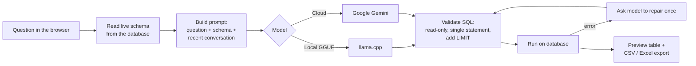

# RAG Database Chatbot

Ask questions about a SQL database in plain language — Bangla, English, Banglish, or a mix — and get back the SQL, a result preview, and downloadable CSV/Excel reports.

```text
You:  গত মাসের disbursement koto?
Bot:  SELECT SUM(...) FROM loan_disbursements WHERE ... LIMIT 100
      → result table preview, plus CSV and Excel download buttons
```

The chatbot reads your database's live schema (tables, views, columns, types, keys, and comments), gives it to a language model as context, and asks the model to write a **read-only** query. The query is checked, run against the database, and the result is shown in the browser. It works with **PostgreSQL** and **MySQL/MariaDB**, and with either a **local GGUF model** (fully offline, through `llama.cpp`) or the **Google Gemini API**.

A ready-made **synthetic microfinance database** (5,000 members, 6,000 loans, collections, savings, and more) can be created in Docker so you can try everything without your own data.

## Contents

- [Features](#features)
- [How it works](#how-it-works)
- [Requirements](#requirements)
- [Setup](#setup)
  - [1. Get the code](#1-get-the-code)
  - [2. Backend](#2-backend)
  - [3. Model](#3-model)
  - [4. Database](#4-database)
  - [5. Frontend](#5-frontend)
  - [6. Use the app](#6-use-the-app)
- [Testing](#testing)
- [Where data is stored](#where-data-is-stored)
- [Privacy when using Gemini](#privacy-when-using-gemini)
- [Safety defaults](#safety-defaults)
- [Troubleshooting](#troubleshooting)
- [Project layout](#project-layout)
- [Roadmap](#roadmap)
- [Demo data disclaimer](#demo-data-disclaimer)

## Features

- Natural-language questions in Bangla, English, Banglish, or mixed language
- PostgreSQL and MySQL/MariaDB support, with a database picker and per-database conversation history
- Two model providers, switched explicitly in the UI (no automatic cloud fallback):
  - **Local GGUF** via `llama-cpp-python` — nothing leaves your machine
  - **Google Gemini** via the Gemini Developer API
- Schema-aware prompts built from live introspection of tables, views, relationships, types, and comments
- Read-only SQL validation (only a single `SELECT` / `WITH` statement is allowed)
- Automatic one-time SQL repair when the database rejects a query
- Conversation memory for follow-up questions; when a drill-down follow-up drops the previous report's date range or top-N group, the SQL is regenerated to keep it
- CSV and Excel export of every result
- Database passwords and API keys encrypted at rest on your machine

## How it works



| Part | Technology |
|---|---|
| Backend API | Python, FastAPI, SQLAlchemy, pandas |
| Database drivers | `psycopg` (PostgreSQL), `PyMySQL` (MySQL/MariaDB) |
| Local model runtime | `llama-cpp-python` with a GGUF model (default: Qwen2.5-3B-Instruct, Q4_K_M) |
| Cloud model | `google-genai` (Gemini Developer API) |
| Frontend | React 19, Vite, TypeScript |
| Demo database | PostgreSQL 18 in Docker |

## Requirements

| Tool | Version | Needed for |
|---|---|---|
| [Python](https://www.python.org/downloads/) | **3.13** (tested). Do not use 3.14 or newer yet — the pinned `pandas 2.2.3` has no prebuilt wheels for it and will fail to install. | Backend |
| [Node.js](https://nodejs.org/) | 20.19+, 22.12+, or 24+ (tested with 22.17) | Frontend |
| [Git](https://git-scm.com/) | any recent version | Cloning |
| [Docker Desktop](https://www.docker.com/products/docker-desktop/) | with Docker Compose v2 | Optional: demo PostgreSQL database |
| C++ build tools ([Visual Studio Build Tools](https://visualstudio.microsoft.com/visual-cpp-build-tools/) on Windows, Xcode Command Line Tools on macOS, `build-essential` + `cmake` on Linux) | — | Optional: only for the local GGUF model |
| ~3 GB free disk and RAM | — | Optional: only for the local GGUF model |
| A [Gemini API key](https://aistudio.google.com/apikey) | — | Optional: only for the Gemini provider |

You need **at least one model provider** (local GGUF *or* Gemini) and **one database** (the Docker demo *or* your own).

## Setup

Commands are shown for **Windows PowerShell** and for **macOS/Linux** where they differ. Run them from the folder shown in each step.

### 1. Get the code

```bash
git clone <this-repository-url> rag_db
cd rag_db
```

### 2. Backend

Create a virtual environment with Python 3.13 and install the dependencies:

```powershell
# Windows PowerShell
cd backend
py -3.13 -m venv .venv
.\.venv\Scripts\Activate.ps1
python -m pip install --upgrade pip
pip install -r requirements.txt
```

```bash
# macOS / Linux
cd backend
python3.13 -m venv .venv
source .venv/bin/activate
python -m pip install --upgrade pip
pip install -r requirements.txt
```

Start the API server (keep this terminal open):

```bash
uvicorn app.main:app --reload --host 127.0.0.1 --port 8000
```

Check it is running: open <http://127.0.0.1:8000/api/health> — it should return `{"status":"ok"}`. Interactive API docs are at <http://127.0.0.1:8000/docs>.

> The frontend expects the backend at `http://127.0.0.1:8000` (set in `frontend/src/api/client.ts`). Keep that host and port unless you change it there too.

### 3. Model

Choose one or both providers. You select the active one later in the app.

#### Option A — Local GGUF model (offline)

**1. Download the model.** The default is [Qwen2.5-3B-Instruct GGUF](https://huggingface.co/Qwen/Qwen2.5-3B-Instruct-GGUF), file `qwen2.5-3b-instruct-q4_k_m.gguf` (about 2.1 GB). Put it in a `models` folder at the project root.

Download in the browser from
<https://huggingface.co/Qwen/Qwen2.5-3B-Instruct-GGUF/resolve/main/qwen2.5-3b-instruct-q4_k_m.gguf>
and save it to `models/`, **or** use the Hugging Face CLI from the project root:

```bash
pip install -U huggingface_hub
hf download Qwen/Qwen2.5-3B-Instruct-GGUF qwen2.5-3b-instruct-q4_k_m.gguf --local-dir models
```

Model files are git-ignored. Any other instruction-tuned GGUF model can be used instead; larger models usually write better SQL but need more RAM. Check the model's license before use (Qwen2.5-3B is released under the Qwen Research License).

**2. Install the local runtime** (with the backend virtual environment active):

```bash
pip install -r requirements-llm.txt
```

`llama-cpp-python` is compiled from source during install, so it needs C++ build tools:

- **Windows:** install [Visual Studio Build Tools](https://visualstudio.microsoft.com/visual-cpp-build-tools/) and select the **"Desktop development with C++"** workload, then open a new terminal and run the install again.
- **macOS:** `xcode-select --install`
- **Linux:** `sudo apt install build-essential cmake` (or your distribution's equivalent)

The backend still starts without this package; chat will just tell you the local runtime is missing.

**3. Configure it in the app** later (step 6): choose **Local GGUF** and enter the full path to the `.gguf` file, for example `C:\path\to\rag_db\models\qwen2.5-3b-instruct-q4_k_m.gguf` or `/home/you/rag_db/models/qwen2.5-3b-instruct-q4_k_m.gguf`.

#### Option B — Google Gemini (cloud)

1. Create an API key in [Google AI Studio](https://aistudio.google.com/apikey). Restrict it to the Gemini API.
2. Nothing else to install — `google-genai` is already in `requirements.txt`.
3. Configure it in the app (step 6). The default model ID is `gemini-3.6-flash`; **Refresh Models** lists the models your key can use.

Read [Privacy when using Gemini](#privacy-when-using-gemini) before using it with a real database.

### 4. Database

#### Option A — Demo PostgreSQL database in Docker (recommended for trying it out)

**1. Create the container's settings file** from the example and choose a password:

```powershell
# Windows PowerShell (from the project root)
Copy-Item docker\postgres.env.example docker\postgres.env
notepad docker\postgres.env
```

```bash
# macOS / Linux (from the project root)
cp docker/postgres.env.example docker/postgres.env
nano docker/postgres.env
```

Replace `replace_with_a_local_password` with a password of your choice. `docker/postgres.env` is git-ignored.

**2. Start PostgreSQL** (from the project root):

```bash
docker compose up -d postgres
docker compose ps
```

Wait until the `rag-db-postgres` container shows `healthy`. It listens only on `127.0.0.1:55432` (not 5432, to avoid clashing with a local PostgreSQL install or reserved ports on Windows).

**3. Create the demo dataset.** The setup script reads the password from the `RAGDB_POSTGRES_PASSWORD` environment variable — set it to the **same** password you put in `docker/postgres.env`. From the `backend` folder, with the virtual environment active:

```powershell
# Windows PowerShell
$env:RAGDB_POSTGRES_PASSWORD = "your-password-from-postgres.env"
python -m database.setup_postgres
```

```bash
# macOS / Linux
export RAGDB_POSTGRES_PASSWORD="your-password-from-postgres.env"
python -m database.setup_postgres
```

The script prints the row counts it created when it finishes. It creates only the `brac_microfinance_demo` database, always generates the same data (fixed seed `20260805`), and refuses to overwrite a database that already has tables. To rebuild it from scratch (this deletes the demo tables):

```bash
python -m database.setup_postgres --reset
```

Other optional environment variables: `RAGDB_POSTGRES_HOST` (default `127.0.0.1`), `RAGDB_POSTGRES_PORT` (default `55432`), `RAGDB_POSTGRES_USER` (default `ragdb`).

**What is in the demo database:** data from January 2024 to 5 August 2026 — regions, areas, branches, staff, village organizations, 5,000 members with KYC and profile updates, 7,000 loan proposals with guarantors and approvals, 6,000 loans with disbursements and repayment schedules, collection receipts and allocations, savings accounts and transactions, monthly portfolio snapshots, and eight reporting views (`vw_member_360`, `vw_member_profile_updates`, `vw_proposal_pipeline`, `vw_loan_portfolio`, `vw_collection_due_vs_actual`, `vw_collection_transactions`, `vw_branch_monthly_kpis`, `vw_product_monthly_kpis`). Before committing, the script checks that schedules, receipt allocations, savings ledgers, balances, and collection dates are consistent.

**Connection details to enter in the app:**

| Field | Value |
|---|---|
| Provider | PostgreSQL |
| Host | `127.0.0.1` |
| Port | `55432` |
| Database | `brac_microfinance_demo` |
| Username | `ragdb` (or `POSTGRES_USER` from `docker/postgres.env`) |
| Password | the password from `docker/postgres.env` |

#### Option B — Your own PostgreSQL or MySQL/MariaDB database

No setup script is needed — just enter your connection details in the app. For safety, connect with a database user that has **read-only** permissions. PostgreSQL schema introspection reads the `public` schema.

#### Legacy MySQL/MariaDB demo

The same synthetic dataset can be created in MySQL/MariaDB. First save a **MySQL / MariaDB** connection in the app (step 6) with a user that can create databases, then from the `backend` folder:

```bash
python -m database.setup_microfinance
```

Use `--reset` to drop and rebuild `brac_microfinance_demo` if it already has objects.

### 5. Frontend

In a **second terminal**, from the project root:

```bash
cd frontend
npm install
npm run dev
```

Open <http://127.0.0.1:5173>.

### 6. Use the app

With the backend (port 8000) and frontend (port 5173) both running:

1. **Database panel** — choose the provider, fill in host, port, database, username, and password, then click **Test** and **Save**. Click **Refresh** to list the databases this user can see; pick one and click **Activate** to switch to it (this starts a new conversation).
2. **Model panel**
   - **Local GGUF:** enter the full path to the `.gguf` file and click **Save & Activate**. (**Test Model** only checks that a path is filled in; the model is actually loaded on your first question, which can take a little while.)
   - **Google Gemini:** paste your API key, click **Refresh Models**, choose a model, click **Test API**, then **Save & Activate**. After saving, the key field can be left blank — the saved key is kept.
3. **Schema panel** — click **Load Schema** to confirm the app can read your tables.
4. **Chat** — ask a question. You get a short answer, the generated SQL, a preview of up to 100 rows, and **CSV** / **Excel** download buttons. Exports contain the same rows as the preview.

Example questions for the demo database:

```text
How many active members are there?
Last month total disbursement koto?
Branch wise active borrowers and principal outstanding dekhao
গত মাসে কতজন নতুন member ভর্তি হয়েছে?
Show proposal count and approval rate by product
Members in PAR 1 category
```

## Testing

The automated tests do **not** need a database, a model, or an API key — those parts are replaced with test doubles.

**Backend** (from `backend`, with the virtual environment active):

```bash
pip install -r requirements-dev.txt
python -m pytest
```

Use `python -m pytest` rather than plain `pytest` so the `app` package is importable.

**Frontend** (from `frontend`):

```bash
npm test
npm run typecheck
npm run build
```

**Manual end-to-end check:** start the Docker demo database, the backend, and the frontend, configure a model, then ask "How many members are there?". The demo dataset has 5,000 members.

## Where data is stored

Everything the app saves stays in the project folder and is git-ignored:

| Path | Contents |
|---|---|
| `data/configs/database.json` | Saved database connection (password encrypted) |
| `data/configs/model.json` | Model settings (Gemini API key encrypted) |
| `data/configs/.local_secret.key` | Encryption key, created automatically on first save. If you delete it, re-enter your passwords and API key. |
| `data/memory/<provider>-<database>/` | Conversation history, kept separate per database |
| `data/exports/` | Generated CSV and Excel reports |
| `models/` | GGUF model files |
| `docker/postgres.env` | Demo PostgreSQL credentials |

Saved settings do not travel with the repository — on a new machine, enter your connection and model settings again in the app.

## Privacy when using Gemini

When **Google Gemini** is the active provider, the backend sends Google the user's question, up to eight recent conversation turns, and schema metadata (database, table, column, type, and key names, plus comments). It does **not** send database credentials, connection settings, result rows, exports, or memory files. When a query fails and is sent back for repair, the database error is reduced to an error code or a generic hint.

The API key is encrypted with the same local key as the database password and is never returned to the browser after saving. Review the [Gemini API terms](https://ai.google.dev/gemini-api/terms) before sending confidential schema metadata — free and paid tiers have different data-use terms.

With **Local GGUF**, no network requests are made for model inference.

## Safety defaults

- Only a single `SELECT` or `WITH` statement is allowed.
- Statements containing keywords such as `INSERT`, `UPDATE`, `DELETE`, `DROP`, `ALTER`, `TRUNCATE`, `CREATE`, or `GRANT` are rejected.
- A `LIMIT` is added when the query has none, and previews are capped.
- Database switching is always explicit.
- Reports are generated locally under `data/exports`.
- The validator is a safeguard, not a security boundary — use a read-only database user, especially for production data.

## Troubleshooting

| Problem | Fix |
|---|---|
| `pip install` tries to build **pandas** and fails | Your Python is too new. Install Python 3.13 and recreate `.venv` with it. |
| `llama-cpp-python` fails to install | Install the C++ build tools listed in [Option A](#option-a--local-gguf-model-offline), open a new terminal, and retry. Or use the Gemini provider instead. |
| Chat says *llama-cpp-python is not installed* | Run `pip install -r requirements-llm.txt` in the backend virtual environment and restart the backend. |
| PowerShell: *running scripts is disabled on this system* when activating `.venv` | Run `Set-ExecutionPolicy -Scope CurrentUser RemoteSigned`, or skip activation and call `.\.venv\Scripts\python.exe` directly. |
| `setup_postgres`: *Set RAGDB_POSTGRES_PASSWORD …* | The environment variable is missing in this terminal. Set it as shown in [Option A](#option-a--demo-postgresql-database-in-docker-recommended-for-trying-it-out) step 3 and run the script again. |
| `setup_postgres`: *password authentication failed* | `RAGDB_POSTGRES_PASSWORD` doesn't match `POSTGRES_PASSWORD` in `docker/postgres.env`. |
| Changed the password in `docker/postgres.env` but it is not accepted | PostgreSQL reads it only when the data volume is first created. `docker compose down -v` deletes the volume **and all demo data**; then run `docker compose up -d postgres` and the setup script again. |
| `setup_postgres`: *already contains tables* | The demo database already exists. Use it as is, or rebuild with `--reset`. |
| Port 55432 is already in use | Change the left side of `127.0.0.1:55432:5432` in `docker-compose.yml`, set `RAGDB_POSTGRES_PORT` to match, and use that port in the app. |
| The browser shows network or CORS errors | Make sure the backend runs on `127.0.0.1:8000` and you open the frontend at `http://127.0.0.1:5173` or `http://localhost:5173`. |
| `npm install` or `npm test` complains about the Node version | Upgrade Node.js to 20.19+, 22.12+, or 24+. |
| The first local-model answer is slow | The model loads into memory on first use; later questions are faster. |

## Project layout

```text
backend/
  app/
    api/          FastAPI routes (/api/...)
    core/         settings, config storage, pydantic schemas
    db/           PostgreSQL/MySQL connections and schema introspection
    llm/          prompt building, local GGUF and Gemini providers, follow-up checks
    memory/       conversation memory
    reports/      CSV/XLSX export
    security/     local encryption helper
    sql_agent/    read-only SQL validation
  database/       demo schema, views, and dataset setup scripts
  tests/          backend tests (pytest)
frontend/
  src/
    api/          backend client
    styles/       app CSS
    test/         test setup
    main.tsx      the React app
data/             local configs, memory, and exports (git-ignored, created at runtime)
docker/           demo PostgreSQL settings (copy postgres.env.example to postgres.env)
models/           GGUF model files (git-ignored, create it yourself)
docker-compose.yml
```

## Roadmap

- Vector indexing for schema descriptions and a business glossary
- An MSSQL connector using the same configuration interface
- Chart previews and saved report templates
- OpenVINO / Vulkan / SYCL acceleration options for Intel GPUs, where practical
- Model profiles for low-end PCs versus dedicated GPU machines

## Demo data disclaimer

The demo microfinance database is entirely synthetic. It contains no BRAC production data and is not an official MRA submission schema. Product parameters, identities, contact details, and transactions are generated demonstration values.
